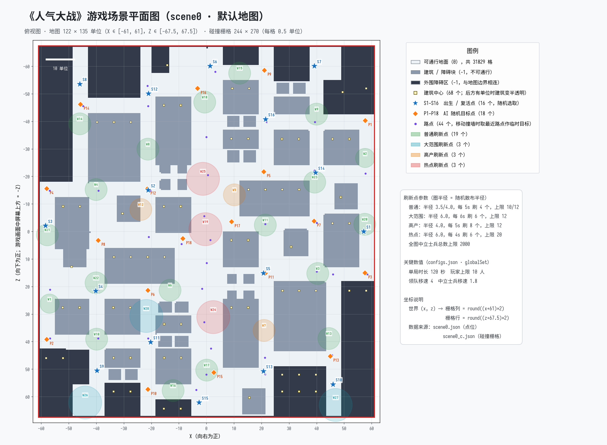

# 人气大战（popular-wars）

基于 LayaAir 3D 引擎的微信小游戏。玩家带领一支队伍，在地图上招募野生 NPC、吞并人数更少的对手，限时内人数最多者获胜。

本仓库保存的是发布后的小游戏产物（`src/game.js` 为打包压缩后的代码），并附带对其源码的分析文档与地图标注工具。

## 玩法概览

- 每局 1 名玩家 + 9 个 AI，限时 120 秒（首局 60 秒）。
- 每支队伍由 1 名队长和若干跟随者组成，玩家只控制队长的移动方向。
- 队伍总人数严格多于对方时，才能吞并对方；招募地图上的野生 NPC 可以壮大队伍。
- 结束时按队伍人数排名，第 1 名获胜。

## 目录结构

| 路径 | 说明 |
|---|---|
| `src/game.js` | 游戏主逻辑（打包压缩后的产物） |
| `src/subContext.js` | 开放数据域脚本 |
| `src/app-config.json` | 小游戏运行配置 |
| `src/resource/configs/configs.json` | 数值配置：段位 `grad`、AI 档位 `ai`、对手资料 `aiInfor`、全局参数 `globalSet`、道具、皮肤等 |
| `src/resource/model/scene0/` | 地图数据：`scene0.json`（出生点、路点、野生刷新点、建筑、导航网格）、`scene0_c.json`（碰撞栅格） |
| `src/resource/`、`src/res/` | UI、模型、音效、头像等美术与音频资源 |
| `ai-logic.md` | AI 完整运行逻辑文档 |
| `scene-map.png` / `scene-map.svg` | 场景平面地图 |
| `draw_scene_map.py` | 地图生成脚本 |

## 文档

- [AI 运行逻辑](./ai-logic.md)：AI 的生成与分档、行为树结构、目标选择、移动与撞墙处理、技能、狙击与送人头、死亡与复活、难度参数表。

## 场景地图



地图标注了出生点、AI 随机目标点、野生 NPC 路点、野生 NPC 刷新点（普通 / 大范围 / 高产 / 热点）、建筑、地图边界、坐标轴、图例和关键数值。

- 坐标系：x 向右，z 向下；X ∈ [-61, 61]，Z ∈ [-67.5, 67.5]。
- 碰撞栅格：244 × 270，每格 0.5 个单位；`0` 可走，`-1` 障碍。

重新生成地图：

```bash
pip install matplotlib numpy scipy
python3 draw_scene_map.py
```

脚本按自身所在位置读取 `src/resource/model/scene0/` 并输出 `scene-map.png` / `scene-map.svg`，可在任意工作目录下运行。中文标注使用 “Sarasa Mono SC” 字体，字体文件路径写在脚本开头（`/usr/local/share/fonts/sarasa-mono-sc/`），本机路径不同或未安装时，需要改成可用的中文字体。

## 说明

`src/game.js` 是压缩后的产物，变量名为压缩名。`ai-logic.md` 的附录给出了关键压缩名与语义名的对照表，便于阅读源码。
