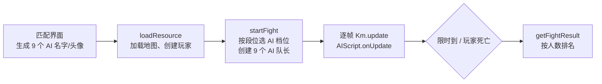
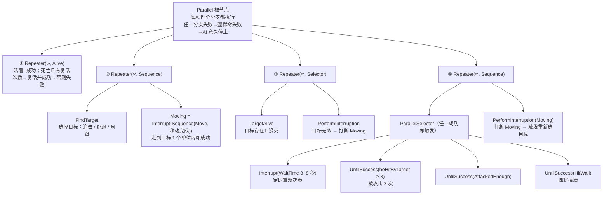
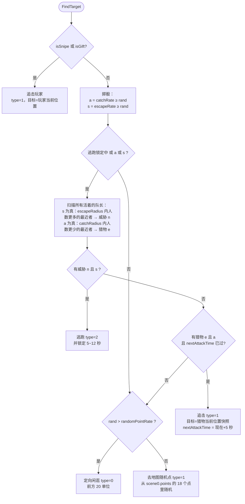

# 《人气大战》AI 运行逻辑

> 依据 `src/game.js`（打包压缩后的产物，变量名为压缩名，下文用语义名称指代，并在附录给出对照表）、`src/resource/configs/configs.json` 以及 `src/resource/model/scene0/` 下的地图数据整理。
> 地图上的出生点、AI 目标点、路点、野生 NPC 刷新点见仓库根目录的 [`scene-map.png`](./scene-map.png)（由 `draw_scene_map.py` 生成）。

---

## 1. 总览

一局游戏由 **1 名玩家 + 9 个 AI** 组成（`scene.playerLimit = 10`），限时 120 秒（首局 60 秒），按结束时各队人数排名，第一名获胜。

每个“队伍”由一个**队长（Leader）**和若干**跟随者（Follow）**组成：

- 队长是 AI 唯一直接控制的对象：AI 每帧只做一件事 —— 给队长设置**移动方向** `setVelocity(cos, 0, sin)`，以及偶尔触发**加速技能**。
- 跟随者按编队偏移自动跟在队长身后，不需要 AI 指挥。
- 吞并、被吞并、碰撞、招募野生 NPC 都是物理层规则，AI 与玩家共用。

AI 的“智能”来自三层：

| 层 | 作用 | 位置 |
|---|---|---|
| 对局层 | 决定有哪些 AI、强度如何、是否针对玩家（动态难度） | `startFight` / `Km.update` |
| 行为树层 | 决定“现在去哪里” | `AIScript`（`Ug`）与一组行为节点 |
| 运动层 | 把“去哪里”变成每帧的转向和位移，并处理撞墙 | `Move` 节点、`Leader.onUpdate`、`Entity.move` |



---

## 2. 对局如何产生 AI

### 2.1 匹配界面是“假匹配”

`Jv.startFight`（`game.js` L12691–12735）向服务端请求 `players`，不足 9 人的部分用本地配置补齐：

- `playerLimit - 1 - 真人数` 即需要补的 AI 数，从 `aiInfor`（214 条昵称、头像、持有皮肤、杯数）中**随机抽取**（`randomAIs`）；
- 匹配界面逐个“加入”对手，只是动画，不影响强度。

补齐后得到 `aiArr`：下标 0 是玩家，1~9 是对手。

### 2.2 按段位选择 AI 档位（`grad.putAi`）

`startFight`（L17168–17216）读取玩家当前段位 `Bp.grad` 对应的 `putAi` 字符串，例如：

```
段位 4（1 阶白银）： "1:1-2,2:1-2,101:20-20"
段位 12（3 阶铂金）："5:1-2,7:5-6,6:20-20,101:0-1"
```

格式为 `AI档位ID:最少-最多`，按顺序展开成一个列表，直到凑满 9 个：

- 数量用 `rr(min, max)` 取整，**区间右开**：`1-2` 实际恒为 1，`3-5` 取 3 或 4，`20-20` 取 20（即“用它补满剩余名额”）。
- 列表第 i 项分配给第 i 个 AI；出生点与此无关（随机）。
- 每一档的最后一项都是 `x:20-20`，所以名额总能补满。

AI 档位 ID 对应 `configs.json → ai` 表（见第 9 节）：1~15 是“新手1 … 变态3”，`101` 是“新手专用”。

低段位例子：段位 1 的 `"1:1-1,101:20-20"` = 1 个“新手1” + 8 个“新手专用”（纯闲逛）。
高段位例子：段位 22 的 `"13:4-6,14:5-7,15:20-20"` = 4~5 个变态1 + 5~6 个变态2，总数封顶 9，空位才由变态3补。

### 2.3 创建 AI 队长（`jg`，L15028–15041）

对每个 AI 做如下初始化：

1. **队长实体**：`new Leader(isAI=true)`，缩放 `leaderRatio=1.4`，基础速度 `moveSpeed=4`，最大速度 `1.5×4`。
2. **道具等级**：`Wm()` 为 4 种道具（移速 / 初始人数 / 暴击 / 离线收益）各随机一个等级。范围取自当前段位的 `propRandom`，且受玩家自身等级限制（`propMaxAdd` / `propMaxMinus`）；玩家连胜越多，范围越向玩家等级靠拢（`straightPropRatio`）。其中：
   - 移速等级 → `propSpeed`，叠加到速度倍率；
   - 暴击等级 → `crit`，每招募一个野生 NPC 有该概率额外再生一个跟随者；
   - 初始人数等级 → 开局额外人数。
3. **初始朝向**：从 `{0°, 90°, 180°, 270°}` 随机选一个。
4. **挂载 AI 脚本**：`setAIDef(def)` + `addScript(new AIScript)`。
5. **AI 自身段位**：`grad = 玩家段位 + floor(6·(rand−0.5))`，即 −3 ~ +2，再限制在 `[1, maxGrad]`。它决定该 AI 的开局人数（`grad.addNum`）。
6. **复活次数**：`startFight` 里统一设为 `reviveCount = 1`（非审核模式）。注意这一步发生在 `setAIDef` 之后，会覆盖 `reviveProb` 的抽签结果（见第 12 节）。
7. **出生点**：从 `spawns`（16 个）里**不放回**随机取一个，剩余的留给其他 AI 和复活使用。
8. **开局人数**：`grad.addNum + initialCount 道具人数`；触发奖励时再 +10。

玩家本人也是同一个 `Leader` 类，只是 `isAI=false`，没有 AI 脚本。

### 2.4 动态难度（针对玩家战绩）

| 条件 | 行为 | 代码 |
|---|---|---|
| 首局（`fightCount==0`） | 整局 60 秒；玩家额外 +5 人；离玩家最近的 AI 成为“送人头”AI（`isGift`） | L17172、L17216 |
| 累计连败 ≥ `totalLoseTimes`(2) | 同样指定一个最近的 AI 为 `isGift`，若它的段位高于玩家，则降到 `max(1, 玩家段位−1)`；清零连败计数 | L17172、L17209 |
| 连胜 ≥ `straightWinTimes`(3) | ① 所有 AI 的 `extraRadius=0.23`（吞并/招募半径更大）；② `randomPointAdd = 0.1×(连胜−3)`，上限 0.5；③ 开启“狙击”（见 §8） | L17191–17212、L17439 |
| 连胜 ≥ 2 | 每个 AI 以 `straightWinBonusProb[连胜−2]`（0.3/0.6/0.8/0.9/1）的概率获得 `extraRadius` 并 +10 人 | L17193、L17212–17214 |

---

## 3. 每帧调用顺序

`Km.update(dt)`（L17415）每帧：

1. `zm += 1000·dt`（`zm` 是全局毫秒时钟，所有“冷却/到期”判断都用它）。
2. 依次更新：**所有队长 → 所有跟随者 → 特效 → 建筑**。
3. 队长更新时，先跑脚本（按添加顺序：`招募脚本 Fy` → `AIScript`），再跑 `Leader.onUpdate`（移动）。
4. 检查狙击触发、野生 NPC 刷新、限时、玩家死亡。

> 脚本的 `_update` 不检查 `enable`，因此队长死亡后 AI 脚本仍在运行，这正是“Alive 节点复活”能工作的原因。

---

## 4. 行为树结构

### 4.1 节点库

AI 用的是一个小型行为树库（L14347–14704）。节点状态：`0=未开始 1=失败 2=运行中 3=成功`。
常用组合节点：`Sequence`（全成功才成功）、`Selector`（一个成功即成功）、`Parallel`、`ParallelSelector`（任一成功即成功）、`Repeater(n)`、`UntilSuccess`、`Interrupt`（可被外部打断的装饰器）、`PerformInterruption`（向指定 `Interrupt` 节点发出打断信号）。

> 读源码时注意：打包后部分模块被写成了逗号表达式，例如 `vg = (ConditionalEvaluator, Interrupt)`，真正生效的是**最后一个**。因此树里的 `vg` 是 `Interrupt`，`yg` 是 `Repeater`，`gg` 是 `UntilSuccess`，`hg` 是 `ParallelSelector`，`_g` 是 `PerformInterruption`。

### 4.2 树的形状（`AIScript.onStart`，L14983–15004）



另有一棵独立的**技能树** `skillBt`，仅当 AI 档位配置了 `checkInterval` 时才创建（见 §7）。

### 4.3 四个分支分别做什么

**① 存活检查（Alive）**
- 活着：成功。
- 死亡且 `reviveCount > 0`：调用 `revive()`（见 §11），返回成功。
- 死亡且无复活次数：失败。`Parallel` 遇到失败立即返回失败，`aiExecutingState` 变为 1，之后 `AIScript.onUpdate` 因为 `1 !== aiExecutingState` 不再运行，AI 永久停止。

**② 找目标 + 移动（主循环）**
`FindTarget` 写入 `aiScript.target`，`Move` 朝它前进；走到 1 个单位内则成功，`Repeater` 重新开始，下一帧再 `FindTarget`。

**③ 目标有效性**
`Selector(TargetAlive, PerformInterruption)`：每帧检查目标。目标对象是**位置快照** `{type, x, z}`，没有 `isDead` 字段，所以这个分支实际只在“还没有目标”的初始帧起作用。

**④ 重新决策触发器**
只要下面任一条件成立，就向 `Moving` 发打断信号，`Moving` 失败后主循环重新 `FindTarget`：

| 触发条件 | 含义 |
|---|---|
| `WaitTime(3, 8)` 到时 | 每 3~7 秒（整数秒，`rr` 右开）重新决策一次 |
| `beHitByTarget ≥ 3` | 自己队伍被攻击（`attack()` 中 `aiScript.beHitByTarget++`）累计 3 次 |
| `AttackedEnough` | 与目标人数差相关的“被打够了”判断（见 §12，实际不会触发） |
| `HitWall` | 下一帧会撞墙或越界；`hitWallLimit` 冷却 30 帧。**狙击/送人头模式下直接返回成功**，等于每帧重新选目标 |

---

## 5. FindTarget：选择目标

`FindTarget`（L14811–14908）输出三类目标：

| `type` | 含义 | 目标点 |
|---|---|---|
| 1 | 追击 / 去随机点 / 狙击玩家 | 目标位置快照 |
| 2 | 逃跑 | 远离威胁的一个点 |
| 0 | 闲逛 | 沿当前朝向前方 20 个单位的点 |

### 5.1 决策流程



要点：

- **逃跑优先于追击**。
- **追击有 5 秒冷却**（`nextAttackTime`），冷却内即使有猎物也不追。
- 比较的是**队伍总人数** `_numEntity`，不是半径或位置。
- 判定半径取自 AI 档位：`escapeRadius`（5~12）、`catchRadius`（5~25）。
- 目标是**快照**，不会跟踪移动的猎物；每次重新决策（3~7 秒内）才更新一次。
- `randomPointRate = catchRate × escapeRate + randomPointAdd`。越强的 AI 越爱跑到地图随机点（变态3 约 64%），新手/简单档几乎为 0，只会定向闲逛。

### 5.2 定向闲逛（`randomPointRate` 未命中时）

不同情形下目标方向的计算：

- **没有撞墙记录**：`方向 = 当前朝向 + (20~40)°`，即始终向同一侧转，地图上看是顺时针（地图 z 轴向下）。每 3~7 秒修正一次，因此无干扰时会走出一个很大的弧线。
- **刚撞过墙**（`wallX/wallZ ≥ 0`）：做“反弹”：
  1. 设朝向角为 θ（0~360°）。默认当作竖墙，镜像 `x = 180 − θ`（正上/正下方向直接掉头）。
  2. 若撞击格左右两侧（`wallX±1`）都不可走，视为横墙/角落，再 `x += 180`，等价于对 z 方向镜像。
  3. 若与原朝向夹角 ≤ 20°（擦墙），`x += 20~40`；若 ≥ 160°（近乎原路返回），`x −= 20~40`，避免来回重复。
  4. 再加随机抖动 `Z`：80% 取 `+10~+30°`，20% 取负值并被 `aiRandomMinAngle(−5)` 截断成 `−5°`。
  5. 目标 = 当前位置 + 20 × (cos(x+Z), sin(x+Z))。
- 选完目标后 `clearHitInfo()` 清掉撞墙记录和 `beHitByTarget`。

### 5.3 逃跑方向

以威胁朝向 `+90°`（垂直于对方行进方向）为中心，在 `−40°~+30°` 范围内每 10° 取一个候选角（共 8 个），沿射线数格子，选“可前进距离最长”的方向，目标点 = 当前位置 + 该方向 × 距离。逃跑状态通过 `escapeEndTime = 现在 + rr(5000, 12000)` 保持 5~12 秒。

### 5.4 狙击 / 送人头

`isSnipe` 或 `isGift` 为真时跳过所有概率判断，直接追击玩家（见 §8）。

---

## 6. Move：移动与转向

`Move` 节点（L14753–14802）每帧计算朝目标的方向并调用 `leader.setVelocity`。

- **到达判定**：与目标距离² ≤ 1（即 1 个单位）视为到达，返回成功。
- **普通目标（闲逛 / 追击 / 逃跑 / 随机点）**：
  朝向每帧向目标方向最多转 **5°**（`5 × Da`），所以转弯是平滑的，大转弯需要多帧。
  这是**直线转向，不做寻路**，遇到墙只能靠 `HitWall` 触发重选目标。
- **狙击 / 送人头目标**：用 `gameMap.findPath`（导航网格寻路，`scene0.json → navInfo`）取路径第一个拐点，**立即**朝它转向（不受 5° 限制）；路径每 30 次执行刷新一次，到拐点 1 个单位内视为到达。
- **队长实际位移**（`Leader.onUpdate`，L15112–15157）：
  `位移 = direction × speed × speedMulti × dt`，位置被夹在地图边界内。
  速度倍率 `speedMulti = 1 + 技能(0.5) + 道具移速 + min((人数−1)/2 × 0.001, 0.3)`，人数加成很小（约每人 +0.05%）。
- **碰撞**（`Entity.move`，L14212–14269）：目标格若是障碍，尝试只沿 x 或只沿 z 滑动；仍不通则原地不动。队长之间互不阻挡，只有被“非 AI 队长（即玩家）”占据的格子才会挡住 AI 队长。

### 地图与寻路数据

| 数据 | 数量 | 用途 |
|---|---|---|
| `spawns` | 16 | 开局出生点、AI 复活点 |
| `points` | 18 | `FindTarget` 的“随机点”目标 |
| `roads` | 44 | 野生 NPC 的游走路点（不用于 AI） |
| `wilds` | 28 | 野生 NPC 刷新点，配置了 `interval/radius/maxCount/onceCount` |
| `mapData` | 244×270，每格 0.5 单位 | `0` 可走，`-1` 障碍，`>0` 被某实体占用的实体 id |
| `navInfo` | 导航网格 | 仅用于狙击 / 送人头的寻路，以及生成碰撞栅格 |

---

## 7. 技能（加速）

技能树 `skillBt`（L15004）：

```
Repeater(∞, endOnFailure=true,
  Sequence( WaitTime(checkInterval[0]~[1] 秒),
            RandomProbability(itemProb),
            UseSkill ))
```

- `UseSkill`：`skillPoint`（初始 2）> 0 时扣 1，并调用 `activeSkillSpeed(skillPlusSpeed=0.5, skillTime=3)`，即 **3 秒内速度倍率 +0.5**；`skillPoint` 为 0 则失败。
- **只要概率检定或技能点任意一次失败，整个技能树永久失败**（节点状态 `failure` 不会复位）。
  因此每个 AI 一局最多用 2 次，期望次数 = `p + p²`（`p = itemProb`）：新手 0.11，变态3 约 0.96。
- “新手专用”（101）没有 `checkInterval`，不创建技能树，永远不用技能。

---

## 8. 狙击与送人头（动态难度的主动手段）

| | 狙击 `isSnipe` | 送人头 `isGift` |
|---|---|---|
| 触发 | 连胜 ≥ 3 且开局 20 秒后，每 0.2 秒检查 | 开局时指定（首局或连败≥2） |
| 对象 | 人数**比玩家多 10% 以上**的 AI 中**离玩家最近**的一个 | 开局时离玩家最近的 AI |
| 持续 | `snipeTime`：25~40 秒随机 | 直到条件不满足 |
| 行为 | 追着玩家走，导航寻路；每帧重选目标 | 同左 |
| 结束 | 超时 / 人数不再比玩家多 / 靠近玩家 8 单位后 50% 概率放弃（只检查一次） | 人数 ≥ 玩家 / 靠近玩家 6 单位 |

狙击的目的是制造压力，送人头则是让玩家“吃”到一个较弱的追击者以获得成就感。两者都忽略追击/逃跑的概率判定。

---

## 9. 难度参数表（`configs.json → ai`）

| ID | 名称 | 逃跑半径 | 追击半径 | 技能检查间隔(秒) | 技能概率 | escapeRate | catchRate | 随机点率¹ | keepGroupProb | reviveProb² |
|---|---|---|---|---|---|---|---|---|---|---|
| 1 | 新手1 | 5 | 5 | 20–50 | 0.10 | 0.20 | 0 | 0 | 0 | 0 |
| 2 | 新手2 | 5 | 5 | 12–14 | 0.10 | 0.20 | 0 | 0 | 0 | 0 |
| 3 | 新手3 | 5 | 5 | 10–12 | 0.10 | 0.20 | 0 | 0 | 0 | 0 |
| 4 | 简单1 | 6 | 6 | 8–10 | 0.15 | 0.25 | 0 | 0 | 0 | 0 |
| 5 | 简单2 | 6 | 6 | 6–8 | 0.15 | 0.25 | 0 | 0 | 0.18 | 0.10 |
| 6 | 简单3 | 6 | 6 | 6–8 | 0.15 | 0.25 | 0.10 | 0.025 | 0.20 | 0.12 |
| 7 | 中等1 | 7 | 7 | 6–8 | 0.20 | 0.30 | 0.10 | 0.03 | 0.25 | 0.14 |
| 8 | 中等2 | 7 | 7 | 6–8 | 0.25 | 0.30 | 0.10 | 0.03 | 0.30 | 0.16 |
| 9 | 中等3 | 8 | 8 | 4–6 | 0.30 | 0.30 | 0.20 | 0.06 | 0.40 | 0.18 |
| 10 | 困难1 | 8 | 10 | 4–6 | 0.35 | 0.40 | 0.30 | 0.12 | 0.50 | 0.20 |
| 11 | 困难2 | 9 | 15 | 4–6 | 0.40 | 0.50 | 0.40 | 0.20 | 0.60 | 0.25 |
| 12 | 困难3 | 9 | 20 | 3–5 | 0.45 | 0.60 | 0.50 | 0.30 | 0.70 | 0.30 |
| 13 | 变态1 | 10 | 25 | 3–5 | 0.50 | 0.70 | 0.60 | 0.42 | 0.80 | 0.35 |
| 14 | 变态2 | 11 | 25 | 3–5 | 0.55 | 0.80 | 0.70 | 0.56 | 0.85 | 0.40 |
| 15 | 变态3 | 12 | 25 | 3–5 | 0.60 | 0.80 | 0.80 | 0.64 | 0.90 | 0.50 |
| 101 | 新手专用 | 0 | 0 | — | 0 | 0 | 0 | 0（仅受连胜加成） | 0 | 0 |

¹ 随机点率 = catchRate × escapeRate（连胜时再加 `randomPointAdd`，最高 +0.5）。
² 实际无效，见 §12。

可以看到，难度随档位升高体现在：看得更远（半径）、更敢追（catchRate）、更会逃（escapeRate）、更常横穿地图（随机点率）、技能更频繁、死后保留队伍的概率更高。

---

## 10. 与战斗规则的交互

AI 只决定方向，以下规则对 AI 和玩家一视同仁（`Entity.move / checkCollision / attack / attackedBy`，L14143–14269、L17503）：

1. **吞并条件**：攻击方所在队伍总人数**严格大于**对方队伍总人数，才能攻击；攻击有冷却 `eatOtherPlayerCd=200ms`。
2. **被吞并的单位**：对方的跟随者被攻击后直接转投攻击方队伍（`attackedBy`），并有 `newEatingPlayerCd=200ms` 的冷却。
3. **队长被击杀**：只有队伍只剩队长（`_numEntity==1`）时才会被吃掉；刚缩到 1 人时，对**非队长**攻击者有 200ms 无敌（`invincibleTime`）。击杀者获得 +10 个跟随者并计击杀数。
4. **招募野生 NPC**：每个队伍成员每隔 3 帧扫描 `followNewRadius`（跟随者 0.6，队长 1.2，可被 `extraRadius` 放大）内的野生 NPC（`Fy` 脚本），命中即加入队伍；有 `crit` 概率再生一个。
5. **掉队**（`checkWallCut`）：AI 队伍的跟随者离编队目标超过 `maxRange = floor(人数/15)+6` 时，等待 2 秒（`wallCutTime1`）后再等 0.5 秒（`wallCutTime2`），仍不能归队则变回野生 NPC。该检查只对玩家视野内的 AI 队伍生效。
6. **野生 NPC 刷新**：`Gm/Um` 控制器按 `wilds` 的 `interval` 刷新，总量上限 2000，单点受 `maxCount` 限制。野生 NPC 沿 `roads` 路点游走，路被堵时用 `findNearRoadPoint` 找近路点。

---

## 11. 死亡与复活

AI 队长死亡时 `setDead(true)`：

- 取消招募脚本，清除占用的格子，取消加速；
- `AIScript` 仍在运行，下一次 `Alive` 节点检查时：
  - `reviveCount > 0` → `revive()`：
    - 位置：从 `spawns` 随机取一个点（**不保证没人占用**）；
    - 人数：`keepGroupProb` 命中且历史最大人数大于默认人数时，恢复到**历史最大人数**，否则恢复到**默认开局人数**；
    - `reviveCount--`；
  - 否则整棵树失败，AI 永久停止。

每个 AI 实际只有 **1 次**复活机会（见 §2.3 第 6 点）。

玩家死亡则直接结算（需要“替身/看视频”才能复活，不属于 AI 逻辑）。

结算（`getFightResult`，L17458）：所有队长按**人数降序**排名，人数相同则**死得晚的靠前**；玩家排名第 1 即胜。

---

## 12. 实现细节与疑点

阅读源码时发现的一些现象，供调整或排错时参考（不影响上文对“实际行为”的描述）：

| # | 现象 | 影响 |
|---|---|---|
| 1 | `reviveProb` 在 `setAIDef` 里抽签，但 `startFight` 随后无条件把 `reviveCount` 设为 1 | 配置表里的 `reviveProb` 实际不生效，所有 AI 都有 1 次复活 |
| 2 | `AttackedEnough` 读取 `target.numEntity`，而目标是 `{type,x,z}` 快照，没有该字段 | 该打断条件永远不触发 |
| 3 | `attackEndTime` 初始 0，且全代码没有地方给它赋值 | `FindTarget` 里相关分支恒为假，追击不会“锁定” |
| 4 | `TargetAlive` 与 `Move` 检查 `target.isDead`，快照上没有该字段 | “目标已死亡”不会触发；追击到点即使猎物已死也要走到点才结束 |
| 5 | `Move` 的转向角处理中，当目标方向与当前朝向的差落在 `[180°, 360°)` 时，取值方向与最短路径相反 | 目标在“逆时针 180° 以外”时会多转大半圈 |
| 6 | 逃跑方向的射线检测用的是 `mapData[k][P]`（终点列）而不是当前列 `M` | 判定几乎与路径上真实障碍无关：左侧候选因左边界列全为 `−1` 而距离极短；右侧取决于右边界列（55% 的行为 `−1`）。因此逃跑方向有偏向且不可靠，常靠 `HitWall` 兜底 |
| 7 | 技能树 `endOnFailure` 且失败状态不复位 | 一次检定失败就再不使用技能 |
| 8 | “waitSomeTime” 节点只被 `PerformInterruption` 引用，没有挂进树 | 不起作用 |
| 9 | 追击目标是位置快照 | 追击移动目标时，需要等下一次重新决策才会修正方向 |

---

## 附录 A：压缩名与语义名对照

| 压缩名 | 含义 | 位置 |
|---|---|---|
| `Km`（`$m` 实例） | 战场世界（实体表、地图、狙击、野生 NPC、`update`） | L17530 |
| `Jv`（`Qv` 实例） | 对局流程管理（匹配、开局、结算） | L12876 |
| `Bp` | 玩家数据（段位 `grad`、`fightCount`、`propLevels`） | — |
| `oo` | `configs.json → globalSet` | L17997 |
| `io` | `configs.json → grad`（段位表） | L17997 |
| `ho` | `configs.json → ai`（AI 档位表） | L17997 |
| `ro` | `configs.json → aiInfor`（对手昵称头像） | L17997 |
| `Hg` | 队长类 `Leader` | L15042 |
| `Yy` / `Qy` | 实体基类、可移动实体 | L13268 / L14133 |
| `Fy` | 招募脚本（扫描并吞并野生 NPC / 敌方跟随者） | L14013 |
| `Wy` | 野生 NPC 路点漫游脚本 | L14076 |
| `Ug` / `Fg` | `AIScript` | L14972 |
| `Rg` / `Pg` | `FindTarget` | L14806 |
| `Dg` / `Cg` | `Move` | L14748 |
| `Gg` | `HitWall` | L14954 |
| `Bg` | `AttackedEnough` | L14922 |
| `Ng` | `TargetAlive` | L14943 |
| `Sg` | `Alive` | L14705 |
| `Eg` | `UseSkill` | L14723 |
| `Ig` | `WaitTime` | L14734 |
| `jg` | 创建队长（AI / 玩家） | L15028 |
| `Gm` / `Um` | 野生 NPC 刷新控制 / 刷新点数据 | L16997 / L17045 |
| `Vy` / `Gy` | 游戏地图（栅格、寻路、随机点） | L13851 |

## 附录 B：关键全局参数（`globalSet`）

| 参数 | 值 | 说明 |
|---|---|---|
| `raceTime` | 120 | 单局时长（秒），首局固定 60 |
| `moveSpeed` | 4 | 队长基础速度 |
| `walkSpeed` | 1.8 | 野生 NPC 速度 |
| `followMoveSpeed` | 4 | 跟随者速度 |
| `skillPlusSpeed` / `skillTime` | 0.5 / 3 | 技能加速倍率 / 持续时间 |
| `leaderOtherRadius` / `followOtherRadius` | 1 / 0.4 | 攻击半径 |
| `leaderNewRadius` / `followNewRadius` | 1.2 / 0.6 | 招募半径 |
| `eatOtherPlayerCd` / `newEatingPlayerCd` | 200 / 200 (ms) | 攻击冷却 |
| `straightWinTimes` | 3 | 触发狙击的连胜数 |
| `totalLoseTimes` | 2 | 触发送人头的连败数 |
| `snipeTime` | [25, 40] | 狙击持续时间（秒） |
| `aiRandomMinAngle` / `aiRandomMaxAngle` | −5 / 20 | 闲逛随机角抖动 |
| `wallCutTime1` / `wallCutTime2` | 2 / 0.5 | 跟随者掉队判定时间（秒） |
| `findPathInterval` / `findPathPoints` | 0.3 / 10 | 队长轨迹采样间隔 / 点数（用于编队跟随） |
